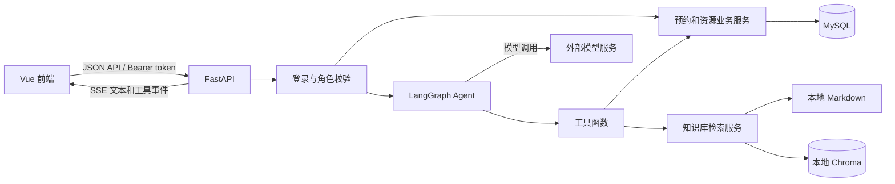
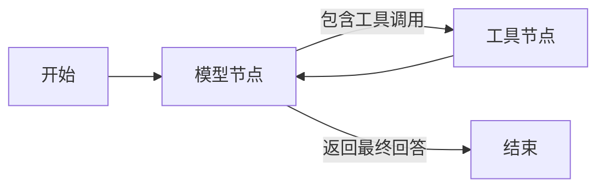

# 系统架构与权限

[返回项目首页](../README.md)

本文对应当前本地开发实现，重点说明业务接口、Agent、知识库和前端之间的职责。

## 整体结构



前端负责表单、请求与状态展示；后端负责身份、业务校验和数据写入。知识库用于说明规则，模型输出和知识库描述都不能替代后端权限检查。

## 代码职责

| 位置 | 职责 |
| --- | --- |
| `frontend/src/views/` | 页面和用户交互 |
| `frontend/src/components/ReserveDialog.vue` | 页面预约表单 |
| `frontend/src/utils/request.js` | Axios token 注入和普通响应处理 |
| `frontend/src/api/ai.js` | Fetch 流式请求和 SSE 事件解析 |
| `backend/app/api/` | 接收 HTTP 请求，调用依赖和服务 |
| `backend/app/dependencies/auth.py` | JWT、账号状态和管理员权限检查 |
| `backend/app/services/reservation_service.py` | 预约创建、查询、取消、审核和过期处理 |
| `backend/app/services/agent_service.py` | 消息转换、Agent 图和流式事件转换 |
| `backend/app/services/agent_tools.py` | 绑定当前用户与数据库会话的工具集合 |
| `backend/app/services/kb_service.py` | 文档同步、嵌入、检索和结果筛选 |
| `backend/app/models/` | SQLAlchemy 数据模型 |
| `backend/app/schemas/` | 请求和响应结构 |

当前启用的聊天接口调用 `agent_service.py`。`ai_service.py` 中仍有早期非流式实现，不是当前页面的聊天入口。

## 登录与权限

注册账号默认是 `student`。登录成功返回 token 和用户信息，前端存入 localStorage；受保护请求携带 Bearer token，后端解码后查询数据库中的当前用户。

| 操作 | 学生 `student` | 管理员 `admin` |
| --- | --- | --- |
| 浏览实验室、设备，使用 AI 问答 | 可以 | 可以 |
| 创建预约，包括通过 AI 创建 | 可以 | 不可以 |
| 查询预约 | 仅自己的记录 | 可查询全部，或按 `user_id` 筛选 |
| 取消预约 | 本人的待审核记录 | 取消接口同样只认记录归属和待审核状态 |
| 审核预约 | 不可以 | 可以 |
| 用户、实验室、设备的管理操作 | 不可以 | 可以 |

预约创建限制位于共享的 `create_reservation()`，因此普通 HTTP 入口与 AI 工具入口都受约束。前端菜单按角色显示，路由守卫主要检查 token 是否存在；角色权限以服务端为准。

## 数据模型

| 表 | 主要内容与关系 |
| --- | --- |
| `users` | 用户、bcrypt 密码哈希、角色和启用状态 |
| `labs` | 实验室位置、容量、开放时间和启用状态 |
| `equipments` | 设备型号、数量和状态；`lab_id` 关联实验室 |
| `reservation` | 关联用户、实验室及可选设备，记录日期、时段和审核状态 |

模型共同拥有 ID、创建时间和更新时间。业务日期与时段当前以字符串保存，输入需要统一为 `YYYY-MM-DD` 和 `HH:mm`。

## 预约流程

1. 获取当前用户，只允许学生创建。
2. 检查日期、结束时间严格晚于开始时间、当天开始时间是否已过去。
3. 检查实验室存在、处于开放状态，时段位于开放时间内。
4. 如果选择设备，检查设备存在、属于该实验室且状态正常。
5. 查询同一天、同一资源上处于待审核或已通过状态的重叠预约。
6. 写入当前用户的预约，状态为待审核并提交事务。

时间重叠条件为：

```text
已有预约开始时间 < 新预约结束时间
并且
已有预约结束时间 > 新预约开始时间
```

因此 `09:00—10:00` 与 `10:00—11:00` 可以首尾相接；`08:00—11:00` 与 `09:00—10:00` 会冲突。

当前按设备 ID 判断设备预约冲突，整间预约则只匹配 `equipment_id` 为空的记录。两类预约之间的互斥、设备数量容量，以及并发请求的原子性保障尚未实现。

| 状态值 | 含义 | 当前主要流转 |
| --- | --- | --- |
| `0` | 待审核 | 管理员通过或拒绝；本人取消；过期自动取消 |
| `1` | 已通过 | 当前取消接口不支持取消此状态 |
| `2` | 已拒绝 | 不支持继续审核或取消 |
| `3` | 已取消 | 不支持继续审核或取消 |

启动时创建一个每隔约60秒执行的任务，将结束时间已过去的待审核记录改为已取消。它依赖后端服务器本地时间；当前未提供独立的任务队列或扫描故障恢复机制。

## Agent 与流式响应

前端发送当前对话的 `role/content`，后端转换为 LangChain 消息，附加系统提示词。每次请求构建一个图，未配置持久化 checkpoint。



工具包括知识库检索、查询开放实验室、查询设备、创建预约、获取日期和查询预约。工具通过闭包引用当前用户和注入的数据库会话，复用业务服务。图配置 `recursion_limit=10`，用于限制图执行步数，不代表允许十次预约或十轮完整对话。

预约前复述参数并等待确认目前是提示词规则，后端没有确认单、确认凭证或请求幂等键。

`POST /api/ai/chat/stream` 通过 SSE 返回以下 JSON 事件：

| `type` | 主要字段 | 页面用途 |
| --- | --- | --- |
| `status` | `message` | 显示思考状态 |
| `tool_start` | `name`、`label` | 展示工具开始 |
| `tool_end` | `name`、`label`、`preview` | 展示工具完成和最多约200字符的结果预览 |
| `token` | `content` | 追加模型文本 |
| `done` | 无额外字段 | 标记正常结束 |
| `error` | `message` | 显示生成过程中发生的错误 |

前端使用 Fetch 读取带 Authorization 的 POST 响应，将 `data: <JSON>\n\n` 分割为事件。工具步骤不放入下一次聊天历史；聊天正文经 Marked 解析，再由 DOMPurify 清理。

## 接口和运行边界

普通响应为 `code/message/data`。业务异常处理器使用 HTTP 200 包装业务错误码；HTTP 异常与参数错误则使用对应 HTTP 状态。流式响应开始后的错误通过 `error` 事件传递。

当前数据库会话由 FastAPI 依赖创建，并在依赖清理阶段关闭。部分工具捕获异常后返回错误文本，预约查询工具还会调用 `rollback()`；其他数据库工具的事务恢复与并发会话使用仍需统一设计。

本项目目前按本地单后端进程组织。多进程部署、事务并发控制、后台任务调度、日志追踪、测试和数据库迁移属于后续工作。
