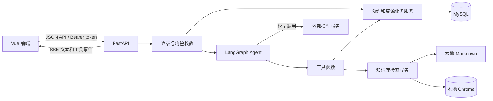
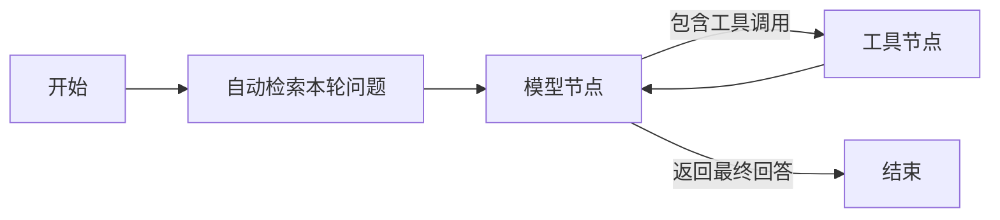

# 系统架构与权限

[返回项目首页](../README.md)

本文对应当前本地开发实现，重点说明业务接口、Agent、知识库和前端之间的职责。

## 整体结构



前端负责表单、请求与状态展示；后端负责身份、业务校验和数据写入。知识库用于说明规则，模型输出和知识库描述都不能替代后端权限检查。

## 代码职责

| 位置 | 职责 |
| --- | --- |
| `frontend/src/views/` | 页面和用户交互 |
| `frontend/src/components/ReserveDialog.vue` | 页面预约表单 |
| `frontend/src/utils/request.js` | Axios token 注入和普通响应处理 |
| `frontend/src/api/ai.js` | Fetch 流式请求和 SSE 事件解析 |
| `backend/app/api/` | 接收 HTTP 请求，调用依赖和服务 |
| `backend/app/dependencies/auth.py` | JWT、账号状态和管理员权限检查 |
| `backend/app/services/reservation_service.py` | 预约创建、查询、取消、审核和过期处理 |
| `backend/app/services/agent_service.py` | 消息转换、Agent 图和流式事件转换 |
| `backend/app/services/conversation_service.py` | 会话归属、分页、删除、上下文读取和消息保存 |
| `backend/app/services/agent_tools.py` | 绑定当前用户 ID、为数据库工具分配独立会话的工具集合 |
| `backend/app/services/kb_service.py` | 文档同步、嵌入、检索和结果筛选 |
| `backend/app/models/` | SQLAlchemy 数据模型 |
| `backend/app/schemas/` | 请求和响应结构 |

当前启用的聊天接口调用 `agent_service.py`。`ai_service.py` 中仍有早期非流式实现，不是当前页面的聊天入口。

## 登录与权限

注册账号默认是 `student`。登录成功返回 token 和用户信息，前端存入 localStorage；受保护请求携带 Bearer token，后端解码后查询数据库中的当前用户。

| 操作 | 学生 `student` | 管理员 `admin` |
| --- | --- | --- |
| 浏览实验室、设备，使用 AI 问答 | 可以 | 可以 |
| 创建预约，包括通过 AI 创建 | 可以 | 不可以 |
| 查询预约 | 仅自己的记录 | 可查询全部，或按 `user_id` 筛选 |
| 取消预约 | 本人的待审核记录 | 取消接口同样只认记录归属和待审核状态 |
| 审核预约 | 不可以 | 可以 |
| 用户、实验室、设备的管理操作 | 不可以 | 可以 |

预约创建限制位于共享的 `create_reservation()`，因此普通 HTTP 入口与 AI 工具入口都受约束。前端菜单按角色显示，路由守卫主要检查 token 是否存在；角色权限以服务端为准。

## 数据模型

| 表 | 主要内容与关系 |
| --- | --- |
| `users` | 用户、bcrypt 密码哈希、角色和启用状态 |
| `labs` | 实验室位置、容量、开放时间和启用状态 |
| `equipments` | 设备型号、数量和状态；`lab_id` 关联实验室 |
| `reservation` | 关联用户、实验室及可选设备，记录日期、时段和审核状态 |
| `reservation_drafts` | 预约快照、确认凭证哈希、到期时间、状态及首次确认幂等键 |
| `conversations` | 所属用户、会话标题；按用户查询 |
| `chat_messages` | 所属会话、user/assistant 角色和文本；按会话查询 |

模型共同拥有 ID、创建时间和更新时间。业务日期与时段当前以字符串保存，输入需要统一为 `YYYY-MM-DD` 和 `HH:mm`。

## 预约流程

1. 获取当前用户，只允许学生创建。
2. 检查日期、结束时间严格晚于开始时间、当天开始时间是否已过去。
3. 检查实验室存在、处于开放状态，时段位于开放时间内。
4. 如果选择设备，检查设备存在、属于该实验室且状态正常。
5. 查询同一天、同一资源上处于待审核或已通过状态的重叠预约。
6. 写入当前用户的预约，状态为待审核并提交事务。

时间重叠条件为：

```text
已有预约开始时间 < 新预约结束时间
并且
已有预约结束时间 > 新预约开始时间
```

因此 `09:00—10:00` 与 `10:00—11:00` 可以首尾相接；`08:00—11:00` 与 `09:00—10:00` 会冲突。

当前按设备 ID 判断设备预约冲突，整间预约则只匹配 `equipment_id` 为空的记录。两类预约之间的互斥和设备数量容量尚未实现。实际预约创建通过共享资源行锁校验冲突，确认单通过行锁和幂等键避免重复确认。

| 状态值 | 含义 | 当前主要流转 |
| --- | --- | --- |
| `0` | 待审核 | 管理员通过或拒绝；本人取消；过期自动取消 |
| `1` | 已通过 | 当前取消接口不支持取消此状态 |
| `2` | 已拒绝 | 不支持继续审核或取消 |
| `3` | 已取消 | 不支持继续审核或取消 |

启动时创建一个每隔约60秒执行的任务，将结束时间已过去的待审核记录改为已取消。它依赖后端服务器本地时间；当前未提供独立的任务队列或扫描故障恢复机制。

## Agent 与流式响应

前端只发送 `conversation_id/message`。后端在开始 SSE 前校验会话归属、提交本次用户消息，读取最近 20 条文本并转换为 LangChain 消息，附加系统提示词。每次请求构建一个图，未配置 checkpoint；聊天文本由业务表持久化。正常生成结束后只保存一次完整助手回复，提交成功才发送 `done`。



工具包括知识库检索、查询开放实验室、查询设备、生成待确认单、获取日期和查询预约。数据库工具每次调用使用自己的 SessionLocal，复用业务服务；预约记录查询和确认单工具通过捕获的用户 ID 重新加载用户，执行状态与权限校验。图配置 `recursion_limit=10`，用于限制图执行步数，不代表允许十次预约或十轮完整对话。

`retrieve_context` 在模型节点之前取最新 HumanMessage，直接调用已有 `search_lab_docs` 工具，并向图状态添加配对的 AI 工具调用与 ToolMessage。调用 ID 每轮重新生成；实际工具事件沿用 SSE 的 `tool_start/tool_end`，不是伪造成功事件。模型仍可改写查询后补查资料，或调用数据库工具。工具消息仅属于本次图执行，不写入聊天文本表。

当最新结果来自知识库时，模型输入末尾附加简短的依据与回答范围约束；该临时 SystemMessage 不累积进图状态或持久化历史。自动检索不增加生成模型调用次数，但每轮多一次本地向量检索，并增加模型上下文，包含寒暄及业务查询；当前不做意图分类。程序保证的是先执行检索，不是保证检索一定成功或最终回答绝无资料外内容。

预约记录工具支持 `created_date`，按记录创建时间筛选指定提交日期，再统计总数及分页。返回值区分 `create_time`（提交时间）与 `date`（预约使用日期），并包含筛选条件、`total`、`returned_count` 和 `has_more`；目前最多返回第一页的 10 条，不提供工具翻页参数。

设备工具 `list_lab_equipments` 的 `lab_id` 可省略，直接复用现有设备服务按名称跨全部实验室查询，无须先枚举开放实验室；指定正整数 ID 时只查询该实验室。查询范围与现有登录用户可用的设备列表接口一致，也包含关闭实验室的登记，不表示这些资源可以预约。返回 `scope/lab_id/keywords` 回显范围，`total` 表示匹配登记条数，`returned_count` 表示本页条数，`returned_quantity` 仅合计本页记录中的 quantity；`has_more=true` 时不能将本页当作完整库存。`summary` 由程序按实际结果生成范围、条数和台数说明，明确登记数量不是时段可预约容量。

预约工具只创建待确认单，不创建真实预约。确认凭证通过 ToolMessage artifact 发送给页面卡片，不进入模型消息正文；用户点击按钮后通过独立接口确认或取消。历史会话目前只恢复文本，不恢复卡片、工具过程或本地操作提示。

`POST /api/ai/chat/stream` 通过 SSE 返回以下 JSON 事件：

| `type` | 主要字段 | 页面用途 |
| --- | --- | --- |
| `conversation` | `conversation_id` | 首事件，记录当前会话 ID |
| `status` | `message` | 显示思考状态 |
| `tool_start` | `name`、`label` | 展示工具开始 |
| `tool_end` | `name`、`label`、`preview` | 展示工具完成和最多约200字符的结果预览 |
| `token` | `content` | 追加模型文本 |
| `reservation_draft` | `data` | 显示当前轮的预约确认卡片 |
| `done` | `conversation_id`、`message_id` | 标记完整助手回复已保存 |
| `error` | `message` | 显示生成过程中发生的错误 |

前端使用 Fetch 读取带 Authorization 的 POST 响应，将 `data: <JSON>\n\n` 分割为事件。历史完全由服务端读取；聊天正文经 Marked 解析，再由 DOMPurify 清理。流结束但没有收到结束事件时，页面提示刷新核对，不默认为成功，也不自动重发消息。

## 接口和运行边界

普通响应为 `code/message/data`。业务异常处理器使用 HTTP 200 包装业务错误码；HTTP 异常与参数错误则使用对应 HTTP 状态。流式响应开始后的错误通过 `error` 事件传递。

普通请求的数据库会话由 FastAPI 依赖创建。聊天在用户消息提交后读取历史并结束只读事务；流式生成阶段使用独立 SessionLocal，会在生成结束或取消时关闭。查询实验室、查询设备、查询预约记录及生成确认单的工具各自创建并关闭独立会话，不与回复保存共用 Session。工具查询失败后的重试会创建新会话；并行工具调用不会共用同一个 ORM Session。

会话及前端已有隔离回归测试，运行方式见 README。本项目目前按本地单后端进程组织；同会话多客户端并发发送/删除的互斥、多进程部署、后台任务调度、日志追踪和数据库迁移属于后续工作。
